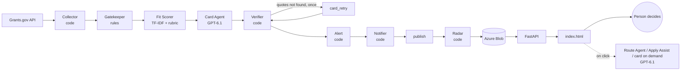

# Federal Funds Matchmaker — NC DNCR

A daily teammate for the one grants developer at the North Carolina Department of Natural and Cultural Resources (DNCR). Every morning it reads the whole Grants.gov feed, drops what DNCR cannot or should not pursue, scores the rest against DNCR's 2025–2029 Strategic Plan, and writes a plain-English decision card, with quotes that are checked, for the few that fit. A person makes every decision. The system never submits an application, sends an email on its own, or touches credentials.

Built for the UNC Solve-a-thon 2026 (OSBM "Federal Funds Matchmaker" challenge). **Independent student prototype — not affiliated with or endorsed by NC DNCR.**

**Live demo:** https://app-ffm-web.salmonsea-3965c0e7.eastus.azurecontainerapps.io · API docs at `/docs`

| | |
|---|---|
| Solution design | [docs/solution-design.md](docs/solution-design.md) |
| GenAI field notes | [docs/genai-field-notes.md](docs/genai-field-notes.md) |
| Agent specs (one per agent) | [docs/agents/](docs/agents/README.md) |
| Web API contract | [docs/api.md](docs/api.md) |
| Azure setup / deploy runbook | [docs/azure-setup.md](docs/azure-setup.md) · [docs/deploy.md](docs/deploy.md) |

## What it does, in one run (live data, 2026-11-07)

| Step | Count |
|---|---|
| Posted + forecasted Grants.gov listings a state can apply for | **1,364** |
| Pass the eligibility, region and timing gates | **891** |
| Scored against the 25 plan objectives (after merging repeat rounds) | **863** |
| Not suggested Skip (worth a look) | **29** |
| Suggested **Chase** (DNCR should apply itself, deadline posted, Final ≥ 38) | **5** |
| Decision cards written by GPT-6.1 and checked by the Verifier | **15** — 52/52 quotes found word-for-word |

The other 834 are suggested Skip and stay searchable. A run takes about 3 minutes cold and about 1 minute when details and cards are cached.

## The user's day

1. **Today** opens on the grants the scorer suggests Chase, ranked by priority. Each compact card shows the priority score, award ceiling, deadline, plan match, one line on what the money pays for, and the one thing to check first (for example *"Eligibility to confirm: … the listing does not say whether DNCR has that designation"*).
2. **Details** groups everything else: strategic fit, eligibility and blockers, funding and competition, effort and timing, the score formula with the real numbers, and the quotes.
3. The AI suggestion (Chase / You decide / Waitlist / Route / Skip) is read-only. The person **Saves**, **Starts tracking** (opens an application starter pack), **Dismisses**, or **drafts a forwarding note** to the office that should apply.
4. **My Tracker** keeps one record per grant: stage (Saved → Reviewing → Preparing → Internal approval → Submitted → Awarded / Declined / Closed), owner, next action and due date, notes, and a change log.
5. **Find Funding** filters, sorts and searches all scored grants instantly — nothing is re-run. Grants outside the morning top 15 can get a card on click.
6. **Radar** shows where federal money is growing or fading by policy area (open and forecast listings vs. those closed in the last 12 months) and how each area fits the plan.
7. A **weekly email** (plus a same-day email only when something can't wait) summarizes what changed; previews at `/api/email/preview`.

## Architecture



- **Agentic workflow, not autonomous agents.** A fixed LangGraph state graph (`graphs/batch_graph.py`). Code does everything that can be computed; the LLM only writes cards for the top 15 and drafts on click. One evaluator–optimizer loop: the Verifier sends missing quotes back to the Card Agent once.
- **LLM gateway** (`core/llm.py`): Azure OpenAI only, scrubs sensitive data before any call, per-model parameters (GPT-6 takes `reasoning_effort`, not `temperature`), structured outputs with Pydantic, retries, a gpt-4.1 fallback, and a JSONL audit log. Tools for agents are read-only and allow-listed (`core/tools.py`).
- **Storage:** JSON files — `./data` locally, Azure Blob in the cloud (`core/storage.py`).
- **Azure:** one container image, three roles — Container Apps Job (daily 10:00 UTC, `MODE=job`), Container App (web + API, `MODE=app`), and a Streamlit fallback (`MODE=streamlit`).

| Agent | Type | Job |
|---|---|---|
| Collector | code | Pages through every posted / forecasted listing open to states (types 00, 25, 99), fetches details in parallel with retries and a 20 h cache |
| Gatekeeper | rules | G1 applicant type · G2 region (other states, territories, Gulf-only RESTORE Act, foreign) · G3 open, not stale |
| Fit Scorer | code | A = plan match (TF-IDF meaning + IDF keywords, research penalty, agency-type floor); P chance, V value, U urgency, W workload; **Final = A × (0.30 + 0.20 P + 0.30 V + 0.15 U/3 + 0.05 W/100)**; suggests Skip / Route / Waitlist / Chase / You decide; who should apply |
| Card Agent | LLM | Writes the card from LISTING and PLAN text only; facts are computed and never quoted; cached by prompt version |
| Verifier | code | Every quote must be found in its source (fuzzy ≥ 90); flags a card that says DNCR cannot apply; sets confidence |
| Radar | code | Growth and DNCR fit by policy area from open, forecast and recently closed listings; served at `/radar` |
| Alert / Notifier | code | Closing soon, waitlist opening, new since yesterday; weekly + urgent email (ACS or SMTP; preview by default) |
| Route Agent / Apply Assist | LLM, on click | Forwarding note to the right NC office; starter pack (requirements, SF-424 fields to gather, outline, timeline) |

## Quick start

```powershell
git clone https://github.com/ErHxyun/Solve-a-thon-2026.git
cd Solve-a-thon-2026
python -m venv .venv
.\.venv\Scripts\Activate.ps1
pip install -r requirements.txt
copy .env.example .env                 # offline defaults; add Azure values privately for live mode
$env:PYTHONUTF8 = "1"                  # needed if your folder path has non-English characters
python pipeline.py                     # offline: 40 real Grants.gov records in tests/fixtures/
uvicorn app.api:app --port 8000        # open http://localhost:8000
pytest                                 # 162 tests, all offline
```

macOS / Linux: `source .venv/bin/activate`, `cp .env.example .env`, `export PYTHONUTF8=1`.

| Setting (`.env`) | Offline (default) | Live |
|---|---|---|
| `COLLECTOR_MODE` | `fixture` | `live` (full Grants.gov pull) |
| `LLM_ENABLED` | `false` (extractive placeholder cards) | `true` (Azure OpenAI) |
| `STORAGE_MODE` | `local` (`./data`) | `blob` |
| `EMAIL_MODE` | `preview` (render only) | `acs` or `smtp` |

Excel report of the top N with every factor: `python scripts/score_report.py --top 50`.

## Repository layout

```
agents/       one file per agent
core/         shared contract: schemas, LLM gateway, guard, tools, storage, config
graphs/       LangGraph wiring for the daily batch (+ stubs for missing agents)
prompts/      system prompts for the LLM agents (versioned)
reference/    DNCR profile (25 objectives), recurring programs, NC program owners, process map
app/          FastAPI (api.py) and a Streamlit fallback
index.html    the web app (vanilla JS; falls back to built-in demo data without the API)
radar/        grant topic radar dashboard (trend view)
scripts/      Excel report, rubric parity check, card-agent eval, fixture refresh
tests/        pytest suite + real Grants.gov fixtures
docs/         design, field notes, agent specs, API contract, Azure runbooks
pipeline.py   daily job entry point · Dockerfile, entrypoint.sh: one image, MODE=job | app | streamlit
```

## Known limitations

- Reads the Grants.gov listing and synopsis, not the full NOFO PDF; eligibility always needs a person to confirm (the UI never shows "Verified" unless a person marked it).
- Grants.gov only; SAM.gov assistance listings and foundations are on the roadmap.
- The rubric's weights and lines were chosen by testing on past wins and a budget simulation; the precision@15 human-label check is in progress (see the solution design).
- Quote verification proves a quote exists, not that the reasoning is right.
- GPT-6 deployments do not accept `temperature`, so card wording can vary between runs; cards are cached by prompt version.
- One shared tracker, no user accounts (pilot scope).

## Team

Lead / orchestration and code agents · Criteria (scoring rubric) · LLM-A (Card Agent, Alert, Notifier) · LLM-B (Route Agent, Apply Assist) · Front end (web app, topic radar). See [docs/agents/README.md](docs/agents/README.md) for owners and workflow.
